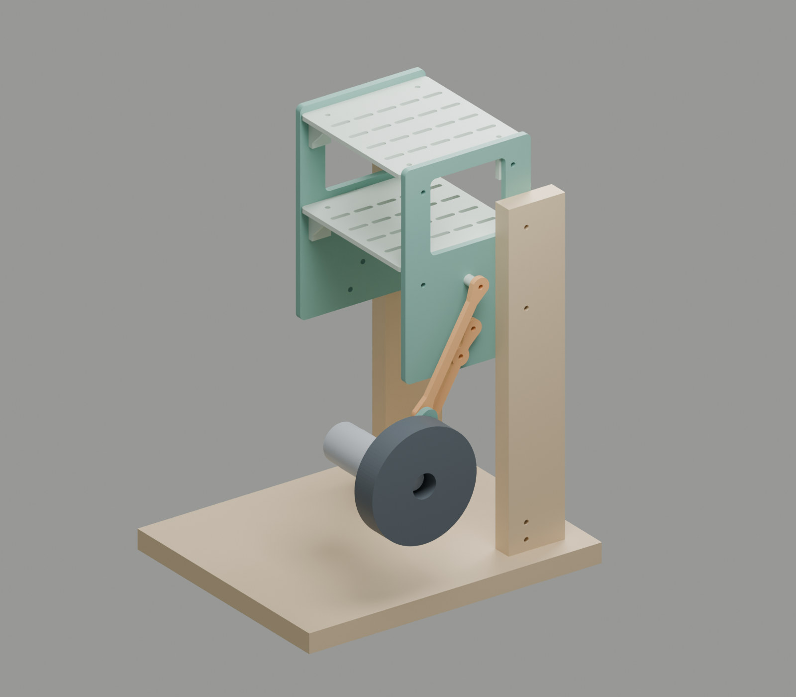
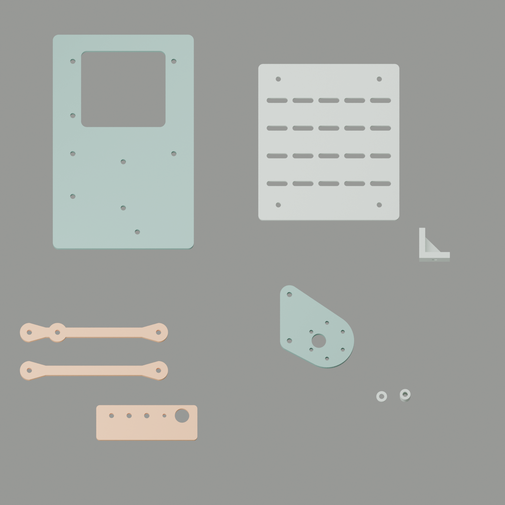

# One-leg body R03

**2026-10-06. A supported body for the next V1-PROOF bench build.** This revision adds a bolted frame, removable equipment decks, a neutral lock and a motor carrier. The first stage uses a fixed leg and a suspended wheel. The bench supply replaces the battery for this stage.

The user reports satisfactory leg travel. The [dated observation](../../../docs/checklists/2026-10-06-leg-motion.md) records that report without inferred measurements. The ST3215 arrival and the current wheel/hub remain unconfirmed. Thus the first-stage scope is an explicit design assumption.

## Files

- [Complete kit](one-leg-body-r03-kit.zip): STL parts, STEP models, drawings, assembly, source and checks.
- [Four engineering sheets](one-leg-body-r03-drawings.pdf): 17 x 11 inches. Sheets 2 and 3 use 1:1 scale.
- [Assembly STEP](one-leg-body-r03.step): editable solid geometry, with separate purchased-part envelopes.
- [Blender assembly and part catalog](one-leg-body-r03.blend).
- [Interface coupon](stl/09_interface_coupon.stl): print this part first.
- [Bambu Studio projects and print record](bambu/README.md): the first fit plate and the complete PLA kit.
- [Export validation](validation.json) and [nominal clearance checks](clearance-audit.json).
- [Dimensions](parameters.json), [part manifest](manifest.json) and [CAD source](build.py).



The wood, motor, hub and tire in the assembly are reference envelopes. They are not printable parts. The model omits fasteners, foot cleats, bench clamps, wires and the catch strap. The assembly requires those items.

## Parts and print order

The user selected default PLA on 2026-10-06. The [Bambu projects](bambu/README.md) use **Bambu PLA Basic, X1C, a 0.4 mm nozzle and textured PEI**. Import STL files at **100% in millimeters**. Do not import the complete assembly as one printable part.

| ID | Part | Quantity | Nominal size in mm |
| --- | --- | ---: | --- |
| 01 | [Body side](stl/01_body_side.stl) | 2 | 120 x 185 x 6 |
| 02 | [Equipment deck](stl/02_equipment_deck.stl) | 2 | 120 x 135 x 4 |
| 03 | [Deck angle](stl/03_deck_angle.stl) | 8 | 26 x 26 x 18 |
| 04 | [Lower link with neutral lock](stl/04_lower_lock_link.stl) | 1 | 110 pivot centers, 24 lock radius, 5 thick |
| 05 | [Motor carrier](stl/05_motor_carrier.stl) | 1 | 63 x 71 x 6, 40 pivot centers |
| 06 | [Upper link](stl/06_upper_link.stl) | 1 | 110 pivot centers, 5 thick |
| 07 | [2 mm spacer](stl/07_spacer_2mm.stl) | 2 | 9 outside diameter, 4.5 bore |
| 08 | [12 mm spacer](stl/08_spacer_12mm.stl) | 2 | 9 outside diameter, 4.5 bore |
| 09 | [Interface coupon](stl/09_interface_coupon.stl) | 1 | 86 x 30 x 4 |

Parts 06, 07 and 08 repeat the R01 interfaces. Reuse those prints if their measured dimensions agree. Part 04 replaces the lower link to provide a positive neutral lock. Part 05 uses the JD-03 R02 motor interface. It replaces the passive R01 carrier and uses a different lateral stack.

1. Print part 09. Check the M4 holes at 4.3, 4.5 and 4.7 mm against the intended hardware.
2. Check the 3.4 mm M3 bore and the 12.4 mm motor-pilot bore.
3. Print one deck angle and check access to both nuts.
4. Print one body side, the lower lock link and the motor carrier.
5. Check the motor pattern, the neutral lock and the complete lateral stack.
6. Print the second side, both decks and the seven remaining angles after those fits agree.

A draft profile uses 0.20 mm layers, five walls and 40% infill. Use solid infill for the small spacers. Print the flat parts on their broad face. Print the deck angle on its triangular gusset. The STL orientation already supplies these faces.

The short transverse holes in the angle require a bridge. Inspect the slicer preview and the printed holes. The largest individual footprint is 120 x 185 mm. Arrange separate build plates with space for any brim. The catalog image is not one X1C plate.



These settings do not establish PLA strength or temperature limits. The full-solid PLA estimate is **483.8 g**, without the coupon, motor, tire, fasteners or fixture. This calculated upper estimate uses 1.24 g/cm3. Use the slicer estimate, then weigh the completed parts.

## Frame assembly

The coordinate origin is the lower body pivot on the near side. X points rearward, Z points up, and depth points outward. All dimensions below are millimeters.

1. Set the near body side at depth 0 to 6. Set the far body side at depth -141 to -135.
2. Place the deck undersides at Z=60 and Z=140. The deck top surfaces are Z=64 and Z=144.
3. Fit four angles below each deck. Align their holes with X=-43 and X=43 on both sides.
4. Use an M4 bolt, washers and a nut at each angle-to-deck and angle-to-side connection.
5. Start with M4 x 16 bolts for these 16 connections. Check the actual washer stack and nut engagement.
6. Square the frame before final fastener retention. Do not crush the printed walls.
7. Fit electronics on insulating board supports or removable carriers. Use the deck slots for screws and strain-relief straps.

The frame envelope is **120 deep x 147 wide x 185 high**. The inside width is 135. This width follows the proposed 230 mm track and the JD-03 wheel stack. It does not release a two-wheel chassis. The empty decks provide space for the Pico, driver and power interfaces without an invented board-hole pattern.

The angle cavity assumes plain 3.2 mm hex nuts and 0.5 mm washers. Thick locknuts can interfere. Longer bolts can contact the transverse bolt. Check both connections together. Use a retention method compatible with the printed material.

## Leg and motor assembly

1. Put the 2 mm body spacer behind the lower link. Its depth is 8 to 13.
2. Put the 12 mm body spacer behind the upper link. Its depth is 18 to 23.
3. Put the motor carrier outboard of both links, at depth 25 to 31.
4. Fit the 12 mm spacer between the lower link and the carrier. Fit the 2 mm spacer above it.
5. Use smooth M4 pivot surfaces, washers and retained nuts. Select bolt lengths against the actual stacks.
6. Keep the lower body pivot hardware below depth 18. Keep the neutral lock hardware below the same limit.
7. Put low-profile carrier bolt heads on the outboard face. Keep at least 1 mm between them and the actual tire.
8. Support the carrier. Align the lower link with the body lock hole at 30 degrees.
9. Fit the removable M4 lock fastener through the body and the lower link. Confirm that it restrains motion.
10. Fit the motor with the shaft 25 mm rearward of the lower carrier pivot. The motor axis is 32 mm rearward.
11. Select six M3 screws for 2 to 3 mm of engagement in the motor. Never exceed 3 mm.
12. Check the shaft flat, metal adapter, wheel seat and all screw clearances before the first wheel trial.

The proposed wheel is the Pololu 3278, 100 x 24 mm, with a metal Pololu 2674 adapter. Neither part is confirmed on hand. The wheel seat depth remains an assumption. Do not print the reference hub or the reference tire as functional parts.

The model places the adapter at depth 34 to 46 and the shaft at 31 to 47. The 3 mm offset is an axial gap. It is not a printed thrust spacer. Verify adapter retention on the shaft flat and clearance from the stationary motor pilot.

The motor pilot bore is 12.4 mm. Six nominal 3.4 mm bores sit on a 31 mm bolt circle. These dimensions follow the existing JD-03 proposal and [Pololu motor drawing](https://www.pololu.com/product/4752). The [adapter drawing](https://www.pololu.com/product/2674) supplies its nominal envelope. Measure the received parts before the full print batch.

## Bench support

The fixture uses stock wood and holds the body independently of the wheel. The lower body pivot is 200 mm above the base top. The nominal wheel clearance above the base is at least 43.75 mm through 15 to 45 degrees.

| Stock | Quantity | Cut size in mm |
| --- | ---: | --- |
| Rigid base | 1 | 280 x 230 x 18 |
| Upright | 2 | 54 x 300 x 18 |
| Foot cleats | As required for rigid attachment | Fit to the available stock and bench clamps |
| Body-to-upright bolts | 4 | M4 x 35 draft length, washers and nuts |
| Foot screws and bench clamps | As required for rigid attachment | Select for the actual wood and bench |

1. Put each upright 20 mm from the forward edge of the base. Its X range is -80 to -26.
2. Put the near upright at depth 6 to 24. Put the far upright at depth -159 to -141.
3. Drill body attachment holes 37 mm from the forward upright edge, at heights 210 and 280 above the base top.
4. Bolt the body through the side holes at X=-43, Z=10 and Z=80.
5. Use rigid foot cleats to secure both uprights to the base. Clamp the base to the bench.
6. Check the fixture for movement before motor attachment. Keep the wheel clear of the base.
7. Add a loose catch strap between the frame and the carrier before removal of the neutral lock.
8. Remove the lock only for supported hand motion. Check the full sweep with the actual wires and fasteners.

The fixture model shows extra pilot holes near each upright foot. Their use depends on the actual cleats. Do not rely on screw withdrawal from the upright end grain. The wood dimensions are a cut plan, not a load rating.

## Power and remaining interfaces

The user confirms sufficient adjustable voltage and current capacity in the bench supply. No new supply is necessary for this design. Exact settings follow the selected rail and the [existing bench procedure](../../../docs/one-leg-bench.md#power-and-interfaces).

The first wheel trial uses the DRV8874, a physical power cut and the measured driver current limit. Supply current under PWM is not motor current. A bench supply does not necessarily absorb motor return energy. Confirm that path before powered deceleration or load trials. The current-capacity report does not establish reverse-energy behavior.

The R03 kit does not include the ST3215 mount, 3:1 belt drive, driven shaft, bearings or leg stops. Those interfaces require the received servo, horn and transmission dimensions. Do not connect servo torque to the printed M4 pivot stack. The one-leg body and decks remain usable while those interfaces progress.

Keep the wheel suspended during this stage. The user did not accept the JD-03 exception for body weight on the motor shaft. This kit does not apply that exception. A floor-loaded build still requires its support decision and measured qualification.

## Verification and source

Nine exported STL files pass checks for closed surfaces, consistent face directions, one solid and positive volume. Their dimensions fit the X1C envelope. An independent mesh section checks every listed through-hole center and diameter. The corresponding STEP files contain valid single solids.

The nominal solid-distance screen covers 1,417 pairs at 13 poses from 15 to 45 degrees. Its minimum is 2.0 mm. That result covers the modeled parts and component envelopes. It excludes wires, fastener heads, actual hardware tolerances and deflection. It is not continuous collision proof or a physical test.

The stationary assembly has no positive overlap of its component bounds. The drawings use the same part manifest. The separate [validation record](validation.json) preserves export hashes. The existing balance simulation retains its R01 axle position. No simulation or physical acceptance result changes with this kit.

Use CadQuery 2.6.1 for `build.py`, with trimesh, numpy, networkx and scipy for `validate.py`. Use ReportLab and trimesh for `drawings.py`, Blender for `render.py`, and pypdf for `package.py`. Edit the CAD source and dimensions together. The independent validator fixes the R03 nominal dimensions and must change deliberately for a new revision.

```sh
python build.py
python validate.py
/Applications/Blender.app/Contents/MacOS/Blender --background --python-exit-code 1 --python render.py
python drawings.py
python package.py
```

Review every PDF page after regeneration. Rebuild the ZIP after the source, exports and notes agree.
