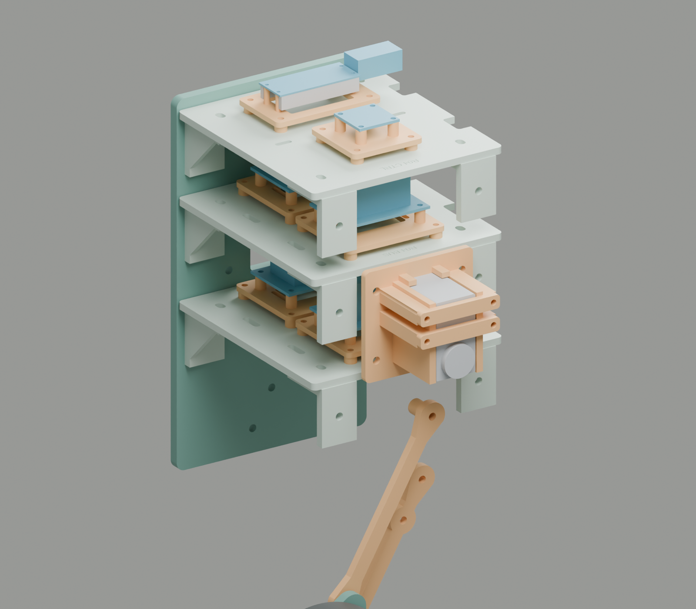

# One-leg body R04

**2026-10-13. Matched three-deck body and component mounts. Fit candidate.**

The user reports that the printed body does not fit together and lacks actuator mounts. R04 replaces the body interfaces. Physical fits remain unverified. The ST3215 servo has not arrived.

- [Complete kit](one-leg-body-r04-kit.zip) and [small first-fit batch](r04-first-fit.zip)
- [Assembly and fit drawings](one-leg-body-r04-drawings.pdf)
- [Assembly STEP](one-leg-body-r04.step) and [Blender assembly](one-leg-body-r04.blend)
- [Part quantities](manifest.json), [CAD checks](validation.json), and [parameters](parameters.json)
- [Dated evaluation](review.md)



Blue shapes show board outlines and reserved component space. They do not specify unselected boards. Wood, electronics, actuators, wheel, hub and service spaces are reference geometry. Print only files from `stl/`.

## What failed in the earlier design

R03 supplies two decks, although the user describes three horizontal plates. The identity of the third plate remains unknown. Do not mix the R01 layout plate with R03 or R04 body parts.

R03 specifies both a 135 mm deck and a 135 mm body opening. This leaves zero nominal side clearance. Its 26 mm angles also put both fasteners in a small cavity. The old clearance check excludes those fasteners and tool access. These are design weaknesses, not measured causes of each reported fit failure.

R03 supplies generic slots without the Pico or IMU hole patterns. It explicitly omits the servo mount. Its motor mount is on the separate carrier, not on a body wall. R04 makes each interface explicit.

## Matched frame

R04 uses **two identical walls, three marked decks and twelve identical angles**. The walls measure 120 x 215 x 6 mm. The body opening remains 135 mm. The lower and middle decks share a hole pattern. Engraved names identify all three decks. Each deck measures 120 x 133.8 x 4 mm, with **0.6 mm nominal clearance at each side**.

The larger angles measure 34 x 34 x 22 mm. Their holes sit 18 mm from the corner. Each deck connection has a 6.6 x 4.6 mm adjustment slot. A 12 mm outside-diameter socket clears the modeled nuts and angle walls.

Use the lower body pivot as the coordinate origin. X points rearward, Z points up, and depth points outward. The near wall occupies depth 0 to 6. The far wall occupies depth -141 to -135.

| Deck | Part | Underside Z | Top Z | Purpose |
| --- | --- | ---: | ---: | --- |
| Lower | 03 | 60 | 64 | DRV8874 driver and power cut/fuse interface |
| Middle | 04 | 120 | 124 | Servo bus, encoder conversion, regulator and protection interfaces |
| Upper | 05 | 170 | 174 | Pico 2 and LSM6DSO IMU |

Put each deck center at depth -67.5. Put the four angles below each deck at X=-44 and X=44. The side holes sit 18 mm below the deck underside. Leave the frame bolts loose until all three decks are in place. Set the inside width to 135 mm, then square the frame. Tighten the bolts without damage to the plastic.

## Component mounts

| Component | Mechanical attachment | Status |
| --- | --- | --- |
| Pico 2 with headers | Part 11, four M2 holes on 47 x 11.4 mm centers, 10 mm standoffs | Published PCB pattern; supplied headers require a fit check |
| LSM6DSO IMU, SEN-18020 | Part 12, four M3 holes on 20.32 mm square centers, 8 mm standoffs | Manufacturer board file; received label remains to verify |
| DRV8874 driver | Part 15, insulating board, soldered 2.54 mm headers or sockets | Driver has no mounting holes; keep its underside and cooling surfaces clear |
| Servo bus and encoder conversion | One removable part 15 cassette on middle deck | Configurable attachment; exact interface boards remain unselected |
| Power cut, fuse and input terminals | One removable part 15 cassette on lower deck | Configurable attachment; switch and fuse hardware remain to identify |
| Regulator and return-energy protection | One removable part 15 cassette on middle deck | Configurable attachment; exact boards remain unselected |
| ST3215 servo | Part 13 case cradle, two part 14 cap bars, four M3 through bolts | Vendor case dimensions; arrival and physical fit remain open |
| Pololu 4752 gearmotor | Part 06 carrier, six M3 holes on a 31 mm circle, 12.4 mm pilot bore | Retains the JD-03/R03 motor interface; adds two cable anchors |

Each removable plate uses four part 23 spacers between the deck and the plate. These **4 mm gaps** provide space for the board screw nuts. Assemble the boards and their supports before attachment to the deck.

Use thin M2 spacers at the Pico. Their outside diameter must not exceed 3.2 mm near the headers. The supplied printed spacer has a 2.2 mm bore. A purchased insulating spacer of the same size is preferable if the small printed wall is weak. The model reserves 3 mm width for each header row. Check the actual yellow header housings and USB plug.

Each part 15 accepts a **52 x 38 x 1.6 mm insulating board**. Drill four 3.2 mm holes on 44 x 30 mm centers. Keep copper and components clear of these holes. Use 8 mm standoffs under the board. The cassette has open underside space and two strap slots.

For the DRV8874, secure its headers or sockets to the insulating board. Align the real pin rows before solder work. Do not put a screw through the driver PCB. Do not cover its IC with a strap or a printed clamp. Route the power wires to separate secured terminals on the same board.

Each interface position reserves 36 x 24 x 22 mm above its insulating board. Parts that exceed this space need a new carrier or an external bench mount. The configurable carriers do not establish exact fits for unidentified power parts. The external bench supply stays on the bench. This revision does not add a battery compartment.

## Servo cradle

The ST3215 case reference measures 24.72 x 45.22 x 35 mm. The cradle gives 0.5 mm side clearance around the case. Its four wall bolts use a 54 x 40 mm pattern. The two cap bars restrain the case without its small case screws. The output axis sits at X=0, Z=81.5.

1. Fit four M3 hex nuts into the rear recesses of the cradle.
2. Attach the cradle to the near wall with four M4 x 16 bolts, washers and nuts.
3. Seat the servo case against the fixed rear supports.
4. Keep both output faces, the case screws and the cable connector clear.
5. Put a thin resilient pad under each cap bar.
6. Fit the cap bars with four M3 x 45 bolts and approximately 1 mm total washer thickness per bolt.
7. Compress the pads only enough to restrain the case.
8. Check that the case cannot move and that both output faces turn freely.

The cradle allows a 36 mm case depth. The bars sit 0.5 mm beyond that envelope. Start with 1 mm pads and check their compression. Do not distort the servo case. Rear access holes in the wall clear the nut recesses and bolt ends. The cradle also has a rear output relief and open connector ends.

The Waveshare 2D download has the title **SCS215**, despite its ST3215 download name. The case dimensions agree with the ST3215 wiki. Treat this source discrepancy as a reason to check the received servo. Do not assume that a picture proves the connector or horn fit.

This mount supports servo bench tests. It does not complete the powered leg transmission. The 3:1 belt drive still needs its supported driven shaft, bearings, pulleys, hard stops and measured horn interface. Do not connect servo torque to the passive M4 leg pivots. The first assembled stage retains the neutral lock and suspended wheel.

## Motor and passive leg

Reuse R03 parts 04, 06, 07 and 08 only if their measured fits agree. Their R04 equivalents are parts 07, 08, 09 and 10. The 110 mm links, 40 mm pivot spacing and lateral stack remain unchanged.

| Connection | Spacer |
| --- | ---: |
| Body to lower link | 2 mm |
| Body to upper link | 12 mm |
| Lower link to carrier | 12 mm |
| Upper link to carrier | 2 mm |

The lower link occupies depth 8 to 13. The upper link occupies depth 18 to 23. The carrier occupies depth 25 to 31. Use smooth pivot surfaces and retained nuts. Do not clamp a moving link between fixed faces. Check play, free motion and every bolt end with the actual washers.

The motor gearbox mounts against the inboard face of part 06. The shaft hole sits 25 mm rearward of the lower carrier pivot. The motor axis sits 32 mm rearward. Use six M3 screws with **2 to 3 mm engagement**, never more than 3 mm. An M3 x 8 screw through the 6 mm carrier starts at 2 mm engagement without a washer. Measure the actual stack before installation.

The R03 motor carrier remains usable if it fits. The R04 carrier adds cable anchors only. A short tie through both slots restrains the harness above the motor. Keep the tie head inboard and clear of the links. Leave a service loop for the whole leg sweep.

## Fasteners and stock

Lengths assume the stated plain nuts and thin washers. Check thread engagement and tip clearance on the small samples before the full build.

| Item | Quantity | Use |
| --- | ---: | --- |
| M4 x 16, plain nuts, two 0.5 mm washers per bolt | 24 | Twelve frame angles, two connections each |
| M4 x 16, plain nuts and washers | 4 | Servo cradle to body |
| M3 x 45, four plain nuts, washer stacks totaling about 1 mm per bolt | 4 | Servo cap bars |
| M3 x 16, nuts and thin washers | 24 | Six removable plates to decks, through 4 mm foot spacers |
| M3 x 16, nuts and thin washers | 20 | Four interface boards and the IMU, through 8 mm standoffs |
| M2 x 18, nuts and insulating washers | 4 | Pico, through 10 mm standoffs |
| M3 x 8, subject to measured engagement | 6 | Motor to carrier |
| M4 pivot hardware and lock fastener | Existing set | Preserve the checked R03 stack |
| M4 x 45, nuts and washers | 4 | Body, fixture spacers and 18 mm uprights |
| Insulating board, 52 x 38 x 1.6 mm | 4 | Configurable electronics carriers |
| Resilient pad, nominal 1 mm | 2 small strips | Servo cap contact |
| Cable ties or removable straps | As required | Cable exits and cassette anchors |

The body needs independent bench support. Use a rigid 280 x 250 x 18 mm base and two 54 x 340 x 18 mm uprights. Set the lower body pivot 200 mm above the base top. The upright X range is -80 to -26. Drill fixture holes at X=-43, Z=10 and Z=80 relative to the body pivot.

Put the four 10 mm fixture spacers between the walls and the uprights. The near upright occupies depth 16 to 34. The far upright occupies depth -169 to -151. Attach the uprights with rigid foot cleats, then clamp the base to the bench. Add a catch strap to the carrier. The stock sizes are a cut plan, not a load rating.

## Print and assembly order

Import STL files at 100% in millimeters. Use the broad flat face already at Z=0. Start with the prior X1C PLA settings: 0.20 mm layers, five walls and 40% infill. Use solid infill for spacers. These settings remain a fit-trial baseline.

1. Print part 19, one part 02, part 21 and part 22.
2. Test the M4 x 16 bolts, both nuts and the actual driver/socket together in the corner sample.
3. Check the coupon bores and the 25.72 mm servo width opening.
4. Print one wall and the lower deck after the sample joint fits.
5. Check the deck edge clearance and the four angle positions.
6. Print the second wall, remaining decks and eleven remaining angles after that trial fits.
7. Build each electronics module with its board screws before attachment to the decks.
8. Fit the servo cradle after its nut recesses and access holes agree.
9. Fit the fixture, passive leg, motor carrier and neutral lock.
10. Check the full hand-driven sweep with the actual harness and hardware.

The angle transverse holes need a short bridge. Inspect those holes in the slicer preview and after the print. The cradle prints on its broad rear face. Its rear nut recesses need a short bridge under each pillar. Remove any bridge material before nut installation.

**Replace:** both R03 walls, both R03 decks and all eight R03 angles. R04 adds a third deck and four more angles. **Reuse if fit agrees:** both links, four leg spacers and the existing motor carrier. The part manifest includes these reused parts for a complete kit. The coupon and two joint samples are test pieces, not assembly pieces.

**2026-10-13 first plate complete:** the user confirms completion of the four small Basic PLA fit parts. Bambu Studio shows 100%, 110/110 layers and Finished. The corner joint fit and measured dimensions remain unverified. See the [Bambu Studio project and print record](bambu/README.md).

The user then requested further prints before the joint check. The X1C accepted plate 2 with one wall, the lower deck and three more angles. Plate 2 completion remains unverified.

## Validation and rebuild

The validator reopens every STL and STEP. It checks closed meshes, one solid, volume agreement, hole sections, slot sections and nominal dimensions. It checks fixed assembly interference, header space, USB access, both angle bores, fastener separation and socket access.

The leg screen checks 61 poses from 15 to 45 degrees at 0.5 degree intervals. An axis-aligned bound rejects distant pairs before exact distance checks. This is a sampled nominal screen. It excludes flexible cables, print errors, pivot hardware, deflection and the future powered transmission. Actual fits, strength and temperatures still require physical checks.

The separate [vendor servo check](vendor-servo-check.json) reports no overlap with the cradle, bars or wall. Its smallest measured CAD clearance is 0.498 mm. The [component source record](component-sources.json) preserves the download hashes.

The build uses CadQuery 2.6.1. The validator also needs trimesh, numpy, scipy and networkx. The drawings need ReportLab. The renderer uses Blender. The `legacy/` folder contains the unchanged R03 source solids used for the passive leg and motor interface.

```sh
python build.py
python validate.py
# Optional: use the unchanged STEP from the Waveshare download.
python check_vendor_servo.py /path/to/ST3215.step
blender --background --python-exit-code 1 --python render.py
python drawings.py
python package.py
```

Primary references: [Pico 2 mechanical drawing](https://datasheets.raspberrypi.com/pico/pico-2-datasheet.pdf), [SparkFun board files](https://github.com/sparkfun/SparkFun_Qwiic_6DoF_LSM6DSO), [DRV8874 carrier](https://www.pololu.com/product/4035), [motor drawing](https://www.pololu.com/product/4752), and [Waveshare servo drawings](https://files.waveshare.com/upload/0/08/ST3215-2D.zip).
