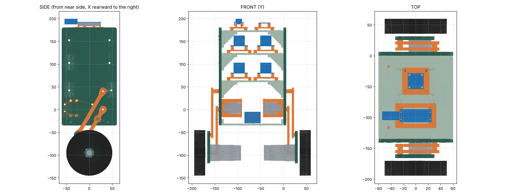

# Two-leg body R05

**2026-10-14, leg drive added 2026-10-16. Two-leg body with rear hips, inner servos, a battery tray and a crank-and-pushrod leg drive. Print candidate.**

R05 follows the [anatomy layout](../../../tools/living-drawings/anatomy.html) and the [2026-10-14 review](../../../docs/checklists/2026-10-14-anatomy-review.md). The user requested new STL files and PLA prints on 2026-10-14. Physical fit, strength and powered tests remain open.



- [Complete kit](two-leg-body-r05-kit.zip), [assembly STEP](two-leg-body-r05.step) and [parameters](parameters.json)
- [Part quantities](manifest.json) and [CAD checks](validation.json)
- [Bambu Studio plates](bambu/README.md)
- [R06 plan](../../../docs/r06-plan.md): the corrections for the next revision

## Changes from R04

| Item | R04 | R05 |
| --- | --- | --- |
| Hips | X = 0, struts slant rearward | X = +30, struts slant forward |
| Legs | One leg | Two legs, the far side is the mirror of the near side |
| Motor carrier | Axle 25 mm rearward of the strut end | Same carrier. The axle and the gearmotor sit toward the hip. |
| Leg range | 15° to 45° | 15° to 40°. The gearmotor clears the lower strut by 2.1 mm at 40° and 0.23 mm at 45°. |
| ST3215 servos | One cradle outside the near wall | Part 25 frame inside each wall, output face toward the wall, at X = −18, Z = +34. Parts 13 and 14 of 2026-10-14 are superseded. |
| Leg drive | None | Part 26 crank hub in a part 27 wall bushing, pushrod to a boss on part 08. Ratio 2.6 to 3.1 : 1 |
| Battery | No position | Part 24 tray at the bottom of the walls |
| Rear lower-deck angles | X = +44 | X = +48, clear of the upper hip nut and its socket |
| Bench fixture | Uprights and fixture holes | Removed |

Coordinates are the R04 body coordinates. X points rearward, Y points outward from the near wall and Z points up. The origin is on the body centre line at the lower hip height.

## Parts

Print one set of the quantities in [manifest.json](manifest.json). The [plate files](bambu/README.md) contain one complete set. Part 19 is the R04 hole coupon. It is not on a plate. Parts 13 and 14 are superseded. Their files are in `legacy/superseded-r05-cradle`.

The walls are identical parts. Each wall has the two hip holes at X = +30, Z = 0 and Z = +40. The neutral lock hole is at X = +18, Z = −20.8. The leg drive uses a 24 mm bore at X = −18, Z = +34. Its four M4 holes are at X = −26 and +16, Z = +17 and +49. The tray uses two M4 bolts in each wall.

**Printed walls of 2026-10-14.** These walls have the superseded cradle holes and not the leg-drive holes. Use the drill jigs, parts 28 and 29, to add the four M4 holes and the bore. Bolt the jig to the hip holes from the outside with two M4 bolts. Drill the four holes at 4.5 mm and the pilot at 3.2 mm. Then open the bore to 24 mm with a step bit or a 15/16 in Forstner bit.

The servo frame (part 25) is 12 mm thick. The ST3215 output face sits in a 1 mm recess on its body face. Four M2 x 10 screws from the wall side hold the servo by its own face holes. Four M4 x 20 bolts from the outside hold the frame to the wall, with nuts in the frame pockets. The 12 mm gap leaves room for the two cable plugs, which exit through the open rear window. The output disc passes through the 20.5 mm window.

The crank hub (part 26) sits on the output disc. Four 2.3 mm pins enter the 14 mm hole pattern of the disc. An M3 x 35 screw through the hub replaces the disc screw. The 18 mm hub passes through the wall bushing (part 27) in a 24 mm wall bore.

The 16 mm crank is in the upper-link plane. The pushrod is 40 mm between ball centres, with RC ball links on 2 mm studs. The upper link (part 08) has a 10 mm boss at 42 mm from the hip.

The battery tray has a flange along each wall and four strap slots. The pack envelope in the CAD is 106 x 35 x 25 mm, as an example. Measure the actual pack before you fit straps.

## Limits

**2026-10-16:** V1-PROOF has no powered hips. Both legs stay locked at 30° with the lock links. The leg drive is now designed and on plate 6, but no leg-drive part is printed, fitted or tested. Keep the lock bolts in until the drive passes a bench test.

## Leg drive

The servo turns 69° for the leg range 15° to 40°. The transmission angles stay between 55° and 90°. At 1.37 N·m on the hip (3 kg robot at 45°), the servo sees 0.44 to 0.53 N·m. The pushrod carries about 33 N.

The ball studs, the ball links and the pushrod are RC parts and are not in the kit. Measure the real pushrod length on the assembly: 40 mm between ball centres at the 30° neutral. The ST3215 disc hardware (pins in the 2.5 mm holes, M3 centre screw) needs a check on the real servo.

Limit the leg to 40° until a hand sweep confirms the gearmotor clearance. Use the neutral lock link for the first balance tests.

## Checks

`validate.py` reopens every STL and STEP and checks each hole section. It checks the fixed assembly, the board fasteners, the servo envelope and the wall bolt envelopes on both walls. It sweeps both legs from 15° to 40° at 0.5° steps, and turns the crank hub and the pushrod with them. The minimum exact clearance is 2.0 mm, at the leg spacers. The minimum gearmotor clearance is 2.1 mm. The minimum leg-drive clearance is 1.0 mm, between the hub and the connector-block envelope.

These are nominal CAD checks. They exclude cables, print errors, deflection, the ball-link bodies and servo backlash.

```sh
pip install -r requirements.txt
python build.py
python validate.py
python bambu/build_plates.py
python package.py
```
