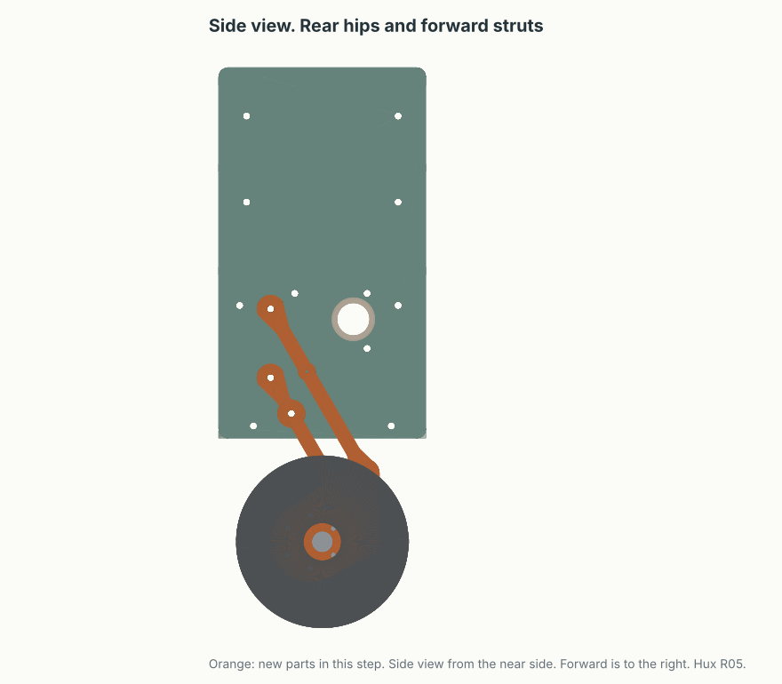
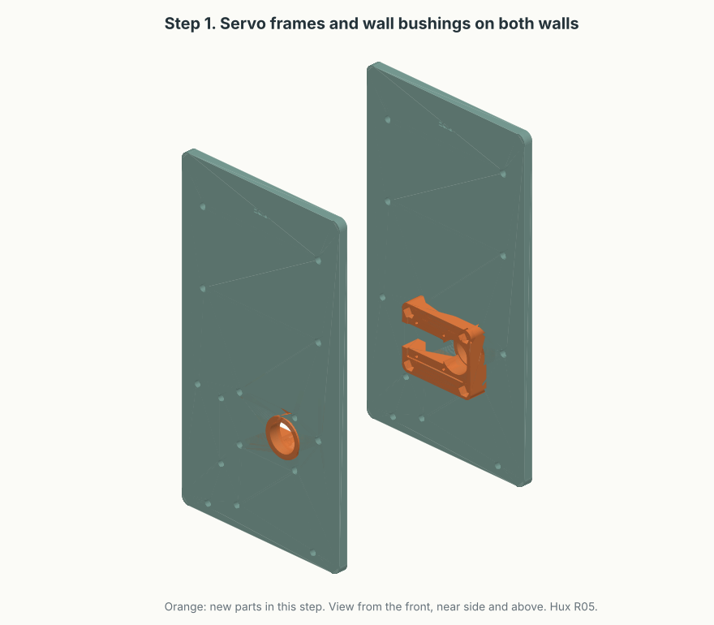
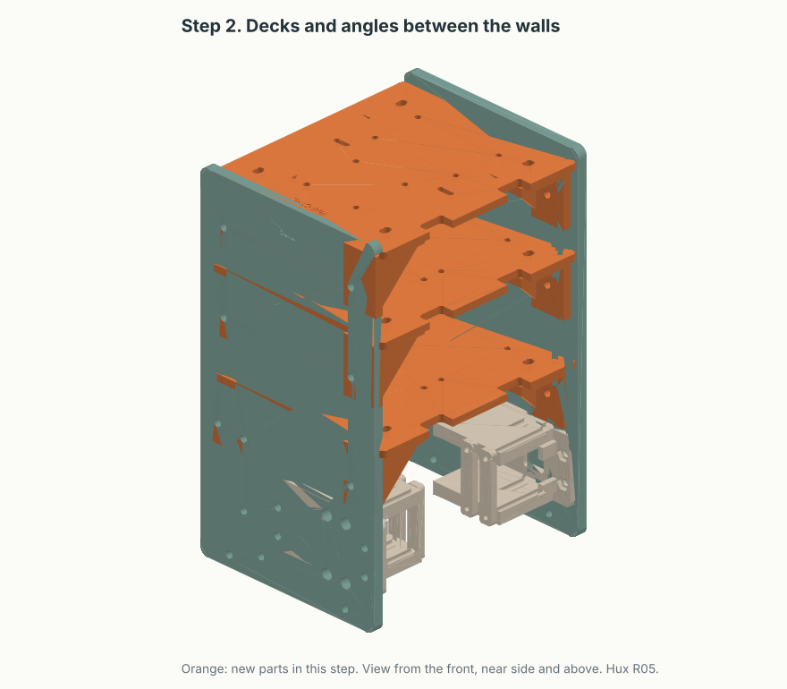
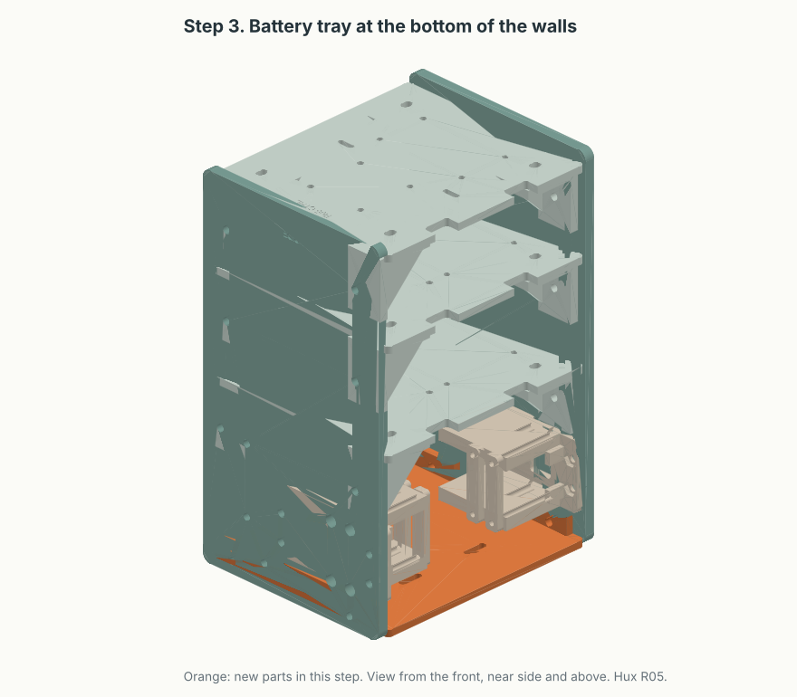
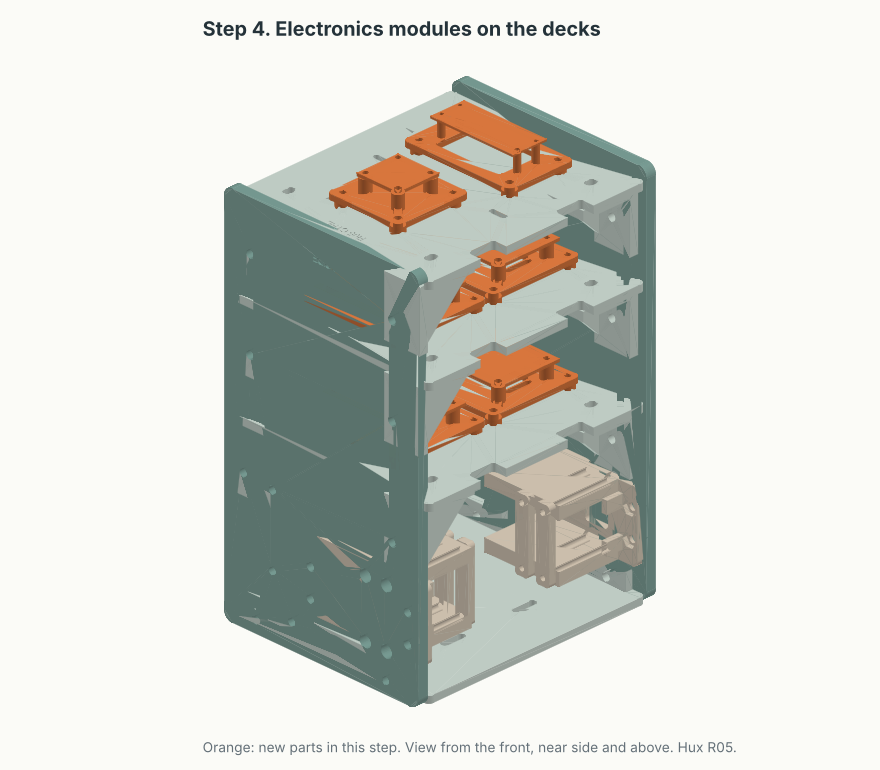
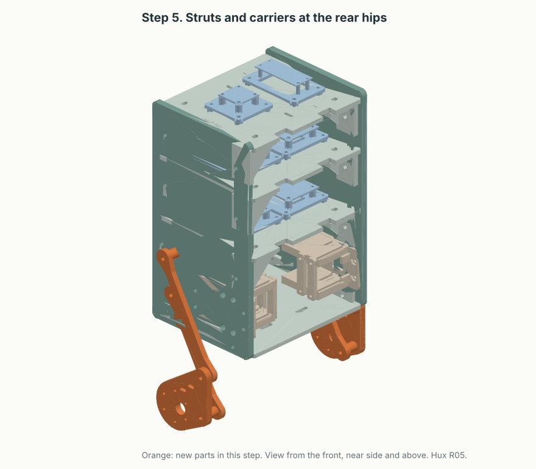
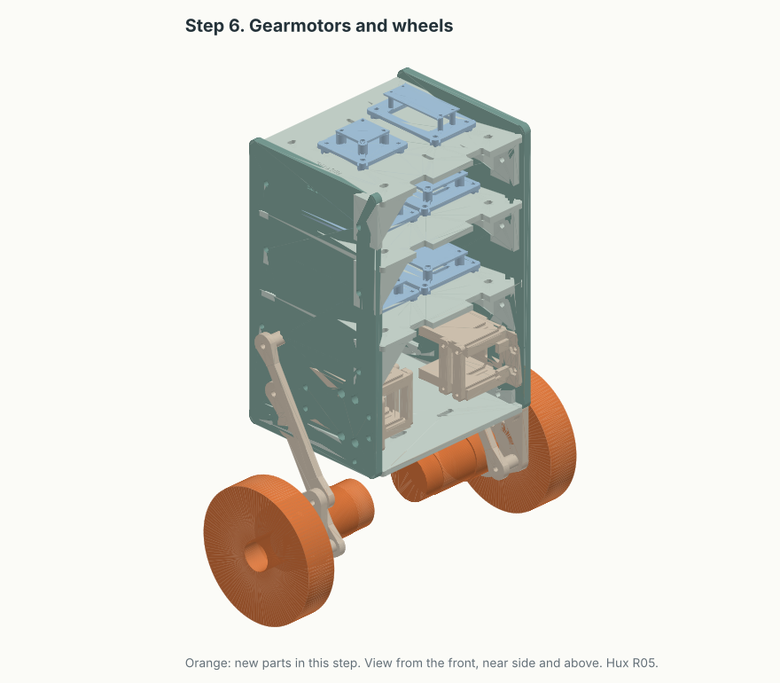
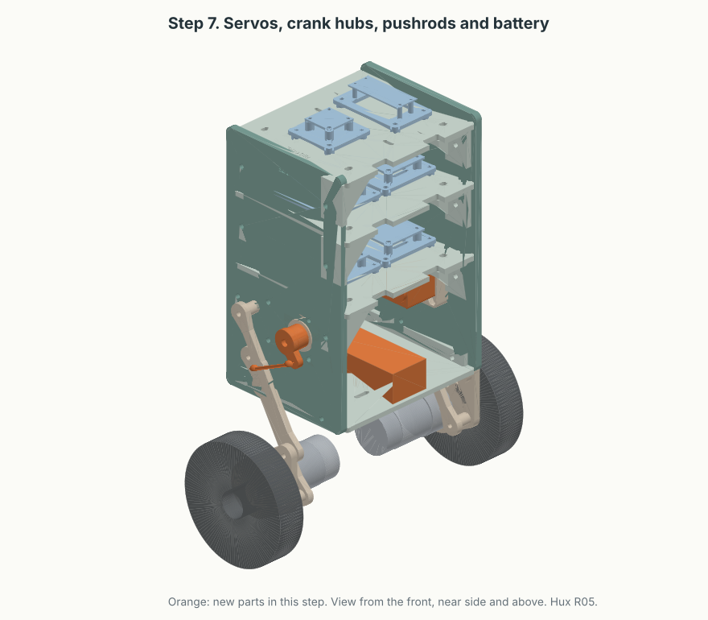

# R05 two-leg body assembly guide

**Revision R05, 2026-10-15.** This guide tells you how to assemble the [R05 two-leg body](../cad/prints/two-leg-body-r05/README.md). It follows the [anatomy layout](../tools/living-drawings/anatomy.html) with rear hips, inner servos and a battery tray. Plates 1, 2 and 3 are printed. Plate 4 is in progress, and plate 5 remains to print. No R05 fit, load or powered test is recorded.

## Before you start

WARNING: Disconnect the battery and the bench supply before you assemble or adjust Hux. A motor or a servo can move and cause injury.

CAUTION: Do not apply servo torque through the M4 hip pivots. The 3:1 servo drive is not designed. Torque through the pivots can cause damage to the walls.

CAUTION: Do not move a leg beyond 40°. At 45° the gearmotor is 0.23 mm from the lower strut. Contact can cause damage to the strut.

### Words in this guide

| Word | Meaning |
| --- | --- |
| Front | The forward direction of Hux. X decreases toward the front. |
| Rear | The direction of the hips. X increases toward the rear. |
| Near wall | The wall that you see in the side view. |
| Far wall | The opposite wall. Its parts are the mirror of the near-wall parts. |
| Hip | The pivot of a strut on a wall. Each wall has a lower hip at Z = 0 and an upper hip at Z = +40. |
| Strut | The lower lock link (part 07) or the upper link (part 08). |
| Neutral | The leg angle of 30°. The lock link holds this angle. |

### Printed parts

Count the parts before you start. The plate column tells you where each part prints.

| Part | Name | Quantity | Plate |
| --- | --- | ---: | ---: |
| 01 | Body wall | 2 | 1 |
| 02 | Deck angle | 12 | 2 |
| 03 | Lower deck, engraved "R05 PWR" | 1 | 2 |
| 04 | Middle deck, engraved "R05 BUS" | 1 | 2 |
| 05 | Upper deck, engraved "R05 CTRL" | 1 | 3 |
| 24 | Battery tray | 1 | 3 |
| 06 | Motor carrier | 2 | 3 |
| 09 | Leg spacer, 2 mm | 4 | 3 |
| 10 | Leg spacer, 12 mm | 4 | 3 |
| 07 | Lower lock link | 2 | 4 |
| 08 | Upper link | 2 | 4 |
| 13 | Inner servo cradle | 2 | 4 |
| 14 | Servo cap bar | 4 | 4 |
| 15 | Interface cassette | 4 | 5 |
| 11 | Pico 2 plate | 1 | 5 |
| 12 | IMU plate | 1 | 5 |
| 16 | Pico standoff | 4 | 5 |
| 17 | Board standoff | 16 | 5 |
| 18 | IMU standoff | 4 | 5 |
| 23 | Module foot | 24 | 5 |

The lower deck and the middle deck look almost the same. On the lower deck, the two rear angle slots are 4 mm nearer to the rear edge. Use the engraved names.

### Hardware

| Item | Quantity | Use |
| --- | ---: | --- |
| M4 x 16 bolt, plain nut, two 0.5 mm washers | 24 | Twelve deck angles, two bolts each |
| M4 x 12 bolt, plain nut, one washer | 8 | Two servo cradles, four bolts each |
| M4 x 16 bolt, plain nut, washer | 4 | Battery tray, two bolts in each wall |
| M3 x 45 bolt, plain nut, washers to 1 mm | 8 | Four cap bars, two bolts each |
| M4 pivot bolt, nut and smooth washers | 8 | Four hips and four carrier pivots |
| M4 lock bolt and nut | 2 | Neutral lock, one each side |
| M3 x 8 screw | 12 | Two gearmotors, six screws each |
| M3 x 16 screw, nut and thin washer | 24 | Six module plates to the decks |
| M3 x 16 screw, nut and thin washer | 20 | Four interface boards and the IMU |
| M2 x 18 screw, nut and insulating washer | 4 | Pico 2 |
| Resilient pad, 1 mm | 4 strips | Servo cap bars |
| Hook-and-loop strap, 20 mm | 2 | Battery |

Measure the pivot bolt length on the actual stack. The stack at each hip is the wall, a spacer and a strut. The stack at each carrier pivot is the strut, a spacer and the carrier. Use the spacer table in step 5.

### Tools

- 2.5 mm and 3 mm hex keys
- 7 mm socket or wrench for M4 nuts, maximum 12 mm outside diameter
- 5.5 mm wrench for M3 nuts
- Calipers
- Square

## Step 0. Check the first parts

1. Remove the brim and loose material from each part.
2. Examine each part for cracks, warped faces and damaged holes.
3. Measure the distance between the two hip holes on each wall. The value must be 40.0 mm.
4. Measure the hip holes from the rear edge of each wall. The centre must be 30 mm from the rear edge.
5. Put one M4 bolt through a hip hole and turn it by hand. The bolt must turn without force.
6. Record each measurement in the [R05 fit record](checklists/2026-10-15-r05-fit-record.md).

If a measurement is more than 0.3 mm from its value, stop. Record the value before you continue.

## Step 1. Install the servo cradles

Install the cradles before the frame assembly. The open walls give better access.

1. Put four M4 nuts into the hex pockets of each cradle base.
2. Put the cradle on the inner face of the wall. The output relief must point to the rear, toward the hips.
3. Install four M4 x 12 bolts from the outer face of the wall, with a washer under each head.
4. Tighten the bolts until the cradle cannot move. Do not crush the cradle base.
5. Look through the 7 mm access holes. Each hole must align with a cap-bar nut pocket.
6. Do steps 1 to 5 again on the second wall.

The two walls are the same part. The cradle on the far wall is the same part, turned over.

## Step 2. Assemble the decks and the angles

1. Attach four angles to each wall with M4 x 16 bolts. Leave the nuts loose.
2. Use the wall holes below each deck height. The rear lower-deck angle uses the hole 48 mm from the centre line.
3. Put the lower deck "R05 PWR" on its four angles. Install the four deck bolts. Leave the nuts loose.
4. Put the middle deck "R05 BUS" and the upper deck "R05 CTRL" on their angles in the same way.
5. Measure the inside width between the walls at each deck. The value must be 135 mm.
6. Put the square against a wall and a deck. Adjust the frame until it is square.
7. Tighten all 24 nuts. Do not crack the angles.

## Step 3. Install the battery tray

1. Put the tray between the walls with the flanges up. The flange notches must point to the rear.
2. Push the tray down until its bottom face aligns with the bottom edges of the walls.
3. Install four M4 x 16 bolts from the outer faces of the walls through the flanges.
4. Tighten the nuts inside the flanges.
5. Look at each lock hole from inside the body. The flange notch must leave the hole clear.

## Step 4. Install the electronics modules

Assemble each module on the bench before you attach it to a deck. The [R04 guide](../cad/prints/one-leg-body-r04/README.md#component-mounts) gives the board hole patterns and the standoff lengths. R05 uses the same modules.

1. Attach the Pico 2 to its plate with four M2 screws and the 10 mm standoffs.
2. Attach the LSM6DSO IMU to its plate with four M3 screws and the 8 mm standoffs.
3. Install both DRV8874 drivers on one 52 x 38 mm insulating board, 3 mm apart. Do not put a screw through a driver board.
4. Prepare the power cut and fuse board, the servo bus board and the regulator board.
5. Attach each module to its deck with four M3 x 16 screws through the module feet.

| Deck | Near half | Far half |
| --- | --- | --- |
| Upper, "R05 CTRL" | IMU | Pico 2 |
| Middle, "R05 BUS" | Regulators | Servo bus and encoder conversion |
| Lower, "R05 PWR" | Power cut and fuse | Two DRV8874 drivers |

Route the harness through the cable exits on the front edge of each deck. Refer to the [wiring atlas](electronics.md) for each connection.

## Step 5. Install the struts and the carriers

Each strut goes from a hip down and forward to its carrier. The carrier stays vertical through the full leg range.

| Joint | Spacer |
| --- | ---: |
| Wall to lower strut, at the lower hip | 2 mm |
| Wall to upper strut, at the upper hip | 12 mm |
| Lower strut to carrier | 12 mm |
| Upper strut to carrier | 2 mm |

1. Install the lower lock link at the lower hip, with a 2 mm spacer against the wall.
2. Install the upper link at the upper hip, with a 12 mm spacer against the wall.
3. Turn both struts so that they point forward and down.
4. Put the carrier outboard of both struts. The motor holes must be to the rear of the strut ends, toward the hips.
5. Install the lower carrier pivot with a 12 mm spacer and the upper carrier pivot with a 2 mm spacer.
6. Tighten each pivot nut until the joint turns freely without play. Do not clamp a strut.
7. Turn the leg to 30°. Install the lock bolt through the lower lock link and the wall.
8. Do steps 1 to 7 again on the other side.

CAUTION: Use the same carrier hand on both sides. The gearmotor must sit toward the hip. A carrier with the motor toward the front puts the wheel 25 mm too far forward.

## Step 6. Install the gearmotors and the wheels

1. Put the Pololu 4752 gearmotor against the inboard face of the carrier, through the 12.4 mm pilot bore.
2. Measure the screw engagement. It must be 2 to 3 mm, never more than 3 mm.
3. Install six M3 x 8 screws. Tighten them in a cross pattern.
4. Attach the hub and the wheel to the motor shaft.
5. Put a cable tie through the carrier anchor slots. Leave a service loop for the full leg range.
6. Do steps 1 to 5 again on the other side.

## Step 7. Install the servos and the battery

1. Put the ST3215 servo into the cradle with the output to the rear and into the body.
2. Put a 1 mm resilient pad under each cap bar.
3. Put the M3 nuts into the base pockets through the wall access holes.
4. Install each cap bar with two M3 x 45 bolts. Tighten until the case cannot move.
5. Do not compress or bend the servo case. Make sure that the output turns freely.
6. Do not connect the servo output to a hip. The belt drive is not designed.
7. Put the 3S pack on the tray between the two servos.
8. Put two straps through the tray slots and around the pack.

Measure the actual pack before you buy straps. The CAD space is 106 x 35 x 25 mm.

## Step 8. Final checks

1. Remove the lock bolt on one side. Hold the leg.
2. Turn the leg slowly from 15° to 40° by hand.
3. Look at the gap between the gearmotor and the lower strut. The gap must be visible at 40°.
4. Make sure that no cable, nut or bolt end touches a part that moves.
5. Install the lock bolt again at 30°.
6. Do steps 1 to 5 again on the other side.
7. Weigh the assembled robot. Record the mass.
8. Find the CoM: balance the robot on a rod below the axle. Record the X position.

Record each result in the [R05 fit record](checklists/2026-10-15-r05-fit-record.md). The simulation uses the measured mass and CoM.

## References

- [R05 kit and CAD checks](../cad/prints/two-leg-body-r05/README.md)
- [R05 print plates](../cad/prints/two-leg-body-r05/bambu/README.md)
- [Anatomy page](../tools/living-drawings/anatomy.html)
- [2026-10-14 layout review](checklists/2026-10-14-anatomy-review.md)
- [Wiring atlas](wiring-atlas.md)
